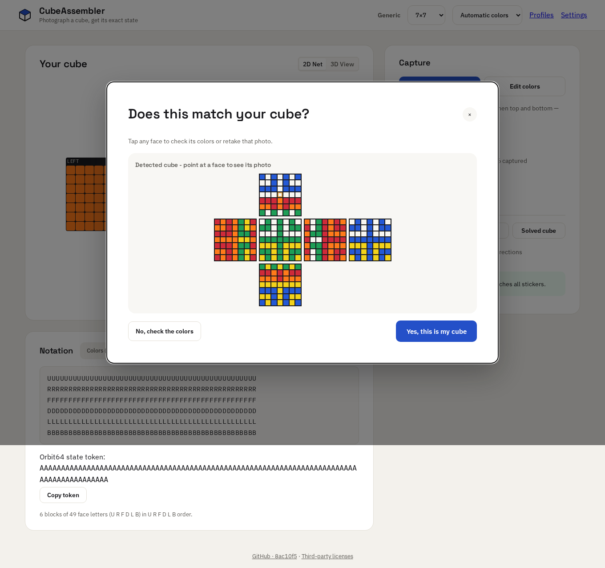
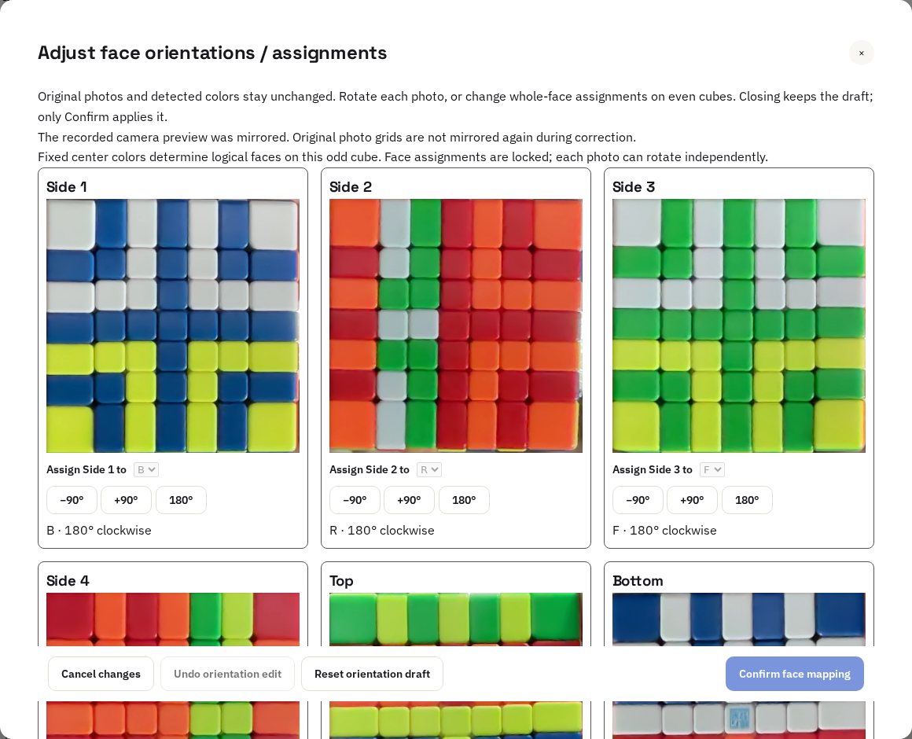

# Correcting captured face orientation and placement

Six correct photographs do not necessarily determine one arrangement. On the
assembly approval screen, **Adjust face orientations / assignments** opens an
editor independently of the number of retained search candidates. **Check the
colors** remains a different action; correction never requires opening a camera.
The same editor can be reopened after closing the approval dialog.

## Three separate records

- Original photos, capture-slot grids, and detected colors remain unchanged.
- The editable mapping assigns each source photo to U/R/F/D/L/B with its own
  clockwise quarter-turn count. Edits are not restricted to solver alternatives.
- The assembled logical cube is validated using the repository's existing
  checks. Net and 3D capture views are derived presentations of that state.

Odd 3×3, 5×5, and 7×7 cubes use their fixed center colors for face identity.
Their assignment selectors are locked. Conflicting or unreadable centers produce
an explanation instead of an automatic reassignment. Even cubes allow six
independent assignment selectors. Duplicate targets are allowed while editing,
but confirmation requires a bijection and passing available checks.

Use −90°, +90°, or 180° for each photograph. Native buttons and selects work with
keyboard and touch; their names include the source photo, target face, and turn.
Undo reverses one edit. Reset restores the editor's initial draft. Closing or
Escape keeps the draft; **Cancel changes** rolls it back without changing the
current cube. Only **Confirm face mapping** commits an orientation decision.
Invalid drafts can be viewed and corrected, but cannot be confirmed as valid.

## Capture pose is not canonical color orientation

The previous guided protocol permitted either lateral direction, flexible tipping,
and swapped caps. Older captures therefore do not prove one absolute pose.
Choose the original front and top photos and confirm that pair, or explicitly
select the logical frame. By default the confirmed capture view shows Side 1
at the front. Net and 3D use the same display transform; picking and completed
turns return through its exact inverse. Camera actions do not change logical
state or history.

A mirrored camera preview does not mirror the cube. Camera sampling and the
original JPEG use sensor coordinates. Correction applies proper rotations only.
New camera shots record the requested step, displayed arrow, and mirrored
presentation. Retakes record `retake/v1` with no claimed guide arrow. For older
captures, unobserved turn direction, cap order, and per-photo observations stay
unknown until the user supplies confirmation.

## Validation and search limits

The approval screen reports retained candidate count and a capped-search flag.
These are not an exhaustive count of possible arrangements. A manual selection
is not reranked back to an automatic candidate.

Existing checks include color balance, pieces, orientation constraints, wings,
and applicable parity checks. Larger NxN checks do **not** certify complete
physical reachability. The editor, main view, and exported validation metadata
state that limit. Known invalid states remain invalid; uncertain relationships
remain unverified. The guided search also rejects improper odd-center frames
that corner and wing checks alone previously admitted.

Camera capture remains 2×2–7×7. Imported 8×8 fixtures support manual assignment,
rotation, validation, and export/reimport; this does not claim 8×8 camera support.

## Backward-compatible fixture metadata

`colorsURFDLB` and `detectedURFDLB` still describe capture slots. The canonical
current cube remains `capture.assembledURFDLB`. New exports additionally contain
`capture.faceRecovery`:

- `version: 1`, `transformConvention: "cube-geometry-orientations/v1"`.
- Exact source-slot `mapping`: `slot`, logical `target`, and `quarterTurns`.
- `captureFrame`: confirmed front/top, proper display and inverse canonical
  transforms, six source-photo-to-display transformations, mirror/protocol,
  physical direction/cap-order confirmation, and actual guide observations.
- `view`: `capture` or `canonical`.
- `stateRelation`: `capture` or `after-viewer-moves`.

The 24 transform indices are frozen by labeled baseline vectors in
`test/captureFrameConventionV1.json`. Changing that convention requires a new
version or an explicit migration. Unsupported versions, invalid enums, duplicate
assignments, invalid rotations, or inconsistent pose transforms do not silently
replace saved manual choices with solver output. Original photos remain
available for correction, with a warning.

The source mapping always describes the initial captured state. A current state
saved after viewport edits is checked separately and clearly marked as having
an unverified relationship to the photos; it is not a proof of a move sequence.
Reopening the orientation editor explains that confirming reconstructs the
original capture and discards later viewport edits. Cancel preserves that state.

Fixtures without recovery metadata remain importable through the legacy search.
An older saved assembly is evidence of a past outcome, not proof of the owner's
intended pose. `assemblyValidation` reports the scope and result of checks rather
than claiming a new reachability certificate.

## Regression evidence

The unchanged owner archive `test/fixtures/orientation-recovery-7x7.zip` pins
capture app commit `8ac10f5`. Its real patterned photographs are exercised by
browser import, manual rotations, confirmed front/top, exact-photo export, and
reimport. Synthetic cases supplement it for odd 3×3/5×5 and even 2×2/4×4/6×6/8×8,
including duplicate drafts and whole-face reassignment. Unit tests cover all 24
presentation frames and inverse turn mapping. Live owner acceptance remains
separate from automated evidence.

## Interface comparison

Before, a valid suggestion provided only color review when rejected:

The editor exposes the six source photographs and explicit correction controls:

